<p align="center">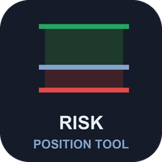</p>

# Risk Position Tool (MetaTrader 5 and MetaTrader 4)

A free position-size calculator that lives on the chart. Drag an entry line, a stop-loss line and a take-profit line; the
panel shows the lot for your risk, the money at the stop and at the target, the reward:risk ratio and the margin. It
**calculates only**: it never places, changes or closes an order. Source for both editions, a Python statement of the
sizing rules, and the property test that checks them.

**Website:** [allanninal.dev/mql5 (utilities)](https://www.allanninal.dev/mql5/#utilities) · [MT4 editions](https://www.allanninal.dev/mql5/#mt4) · [allanninal.dev](https://www.allanninal.dev)
· **Contact:** message me on [LinkedIn](https://www.linkedin.com/in/allanninal/).

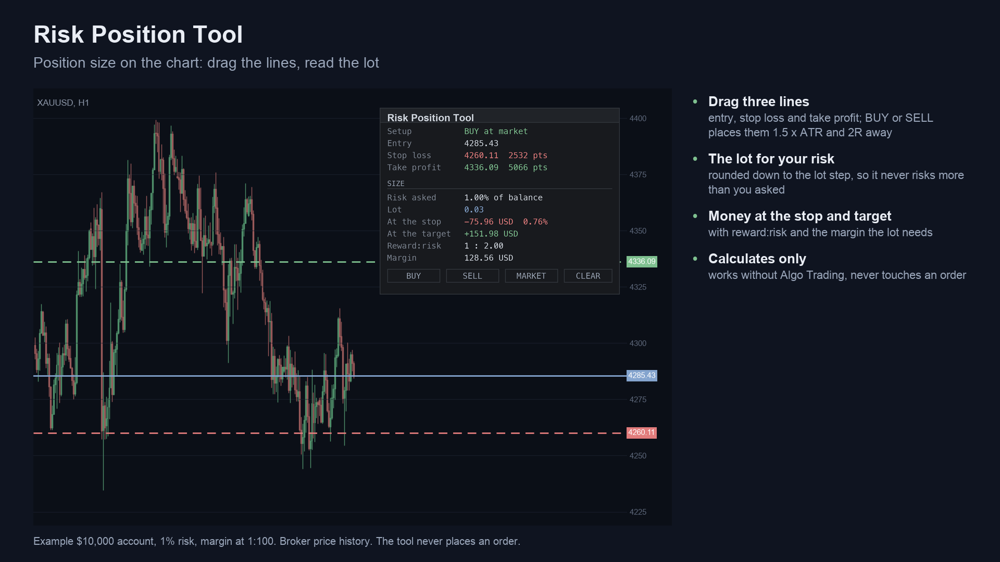

> It is a calculator, not a strategy. It does not choose entries and it makes no profit claim (see
> [Honest limits](#honest-limits)).

## Get it on the MQL5 Market

| Edition | Platform | Price | Link |
|---|---|---|---|
| Risk Position Tool | MT5 | free | <https://www.mql5.com/en/market/product/201865> |
| Risk Position Tool MT4 | MT4 | free | MT4 edition: coming soon on the MQL5 Market |
| Risk Trade Manager MT5 | MT5 | paid | <https://www.mql5.com/en/market/product/201867> |
| Risk Trade Manager MT4 | MT4 | paid | MT4 edition: coming soon on the MQL5 Market |

The MT5 Market build is the same calculation as the source in this repository. The Manager is a separate, paid product
that is **not** part of this repository (see [Free vs Pro](#free-vs-pro)).

## Contents

1. [What it is and who it is for](#what-it-is-and-who-it-is-for)
2. [Why it was built](#why-it-was-built)
3. [How it works](#how-it-works)
4. [How it was tested](#how-it-was-tested)
5. [Architecture](#architecture)
6. [Inputs, install and compile](#inputs-install-and-compile)
7. [Run the Python reference and the test](#run-the-python-reference-and-the-test)
8. [Honest limits](#honest-limits)
9. [Free vs Pro](#free-vs-pro)
10. [Licence](#licence)

## What it is and who it is for

**What:** press BUY or SELL and three horizontal lines appear: entry (at the market price), stop loss and take profit.
Drag any of them. The panel re-computes the lot so that the money lost at the stop is the risk you chose: a percent of
the balance, a percent of the equity, or a fixed amount of money. The lot is **rounded down** to the broker's lot step, so
the money at the stop is never above the risk you asked for. If even the minimum lot would risk more, the panel says so
and shows what that lot would risk, instead of rounding up.

**For:** discretionary traders who want to size every trade from the stop, on any symbol (forex, gold, indices, crypto) and
in any account currency. Also for developers who want a small, tested example of position sizing in MQL5 and MQL4.

**Not for:** anyone who wants the tool to send the order or manage the trade. It only shows numbers.

| | |
|---|---|
| 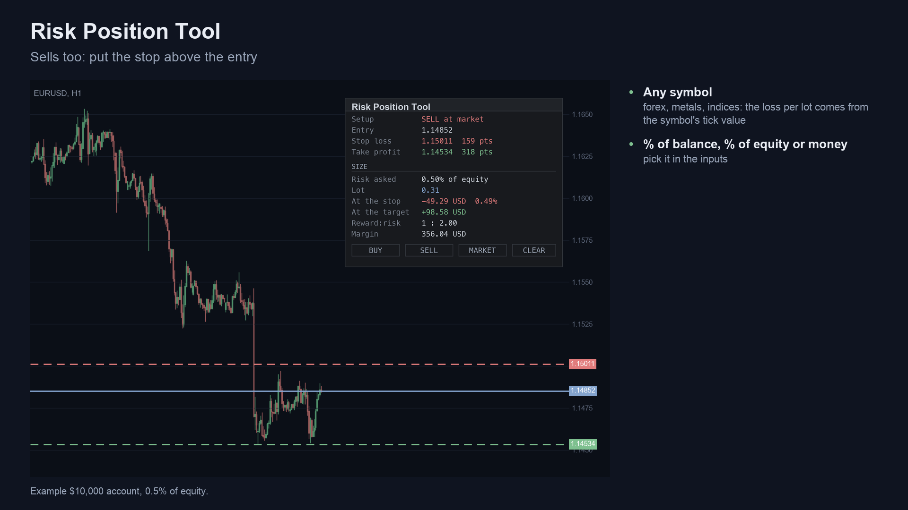 | 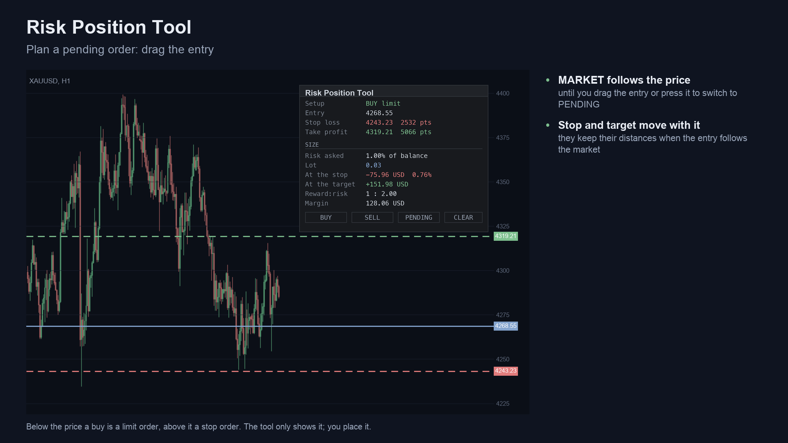 |
| 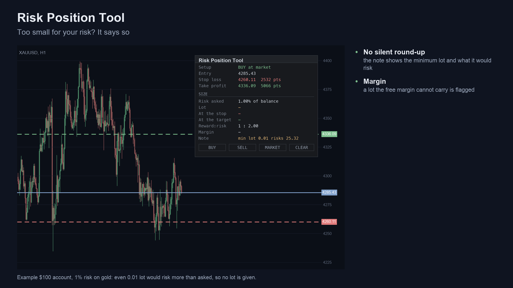 | 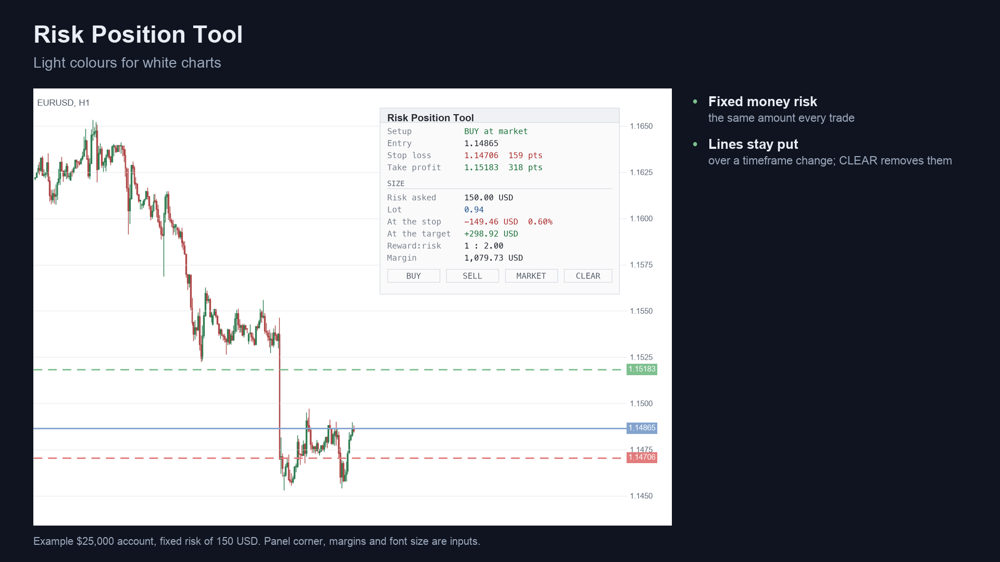 |

Image notes: the charts are drawn from broker history by a script and the panel text is rendered from the program's own
source, so they are illustrations, not terminal captures. MT4 versions are in [`docs/images/mt4/`](docs/images/mt4).

## Why it was built

The motivations, stated with the evidence we actually have:

- **Sizing from the stop is the basic habit, and the tools are scattered.** Our October 2026 market research (MQL5 Market,
  Reddit, GitHub, freelance boards) found "trade manager, break-even, trailing, lot size, risk calculator" is a recurring
  request: 205 matching posts in the Reddit archive sample (77 of them name MT4, MT5 or MQL), and a keyword count finds
  about 125 of 2,014 MQL5 freelance jobs mentioning lot size, position size, risk calculator, trade manager or trade panel.
  The research itself calls MT5 demand on Reddit thin and low-volume; a drag-and-drop lot-size panel was the best-received
  tool post in `r/metatrader` in the 2026 set.
- **The space is crowded.** The same research found a popular free open-source position sizer on GitHub, and
  several free utilities near the top of the MQL5 Market lists next to paid managers with hundreds of reviews. So this is
  not a claim of an unmet need. It is a free, readable tool with source, built to a stricter rule than most: **the money
  at the stop is never above the risk asked**.
- **Provable behaviour.** The rounding and minimum-lot rules are written down in
  [`tests/reference.py`](tests/reference.py) and checked on 200,000 random cases, not promised.

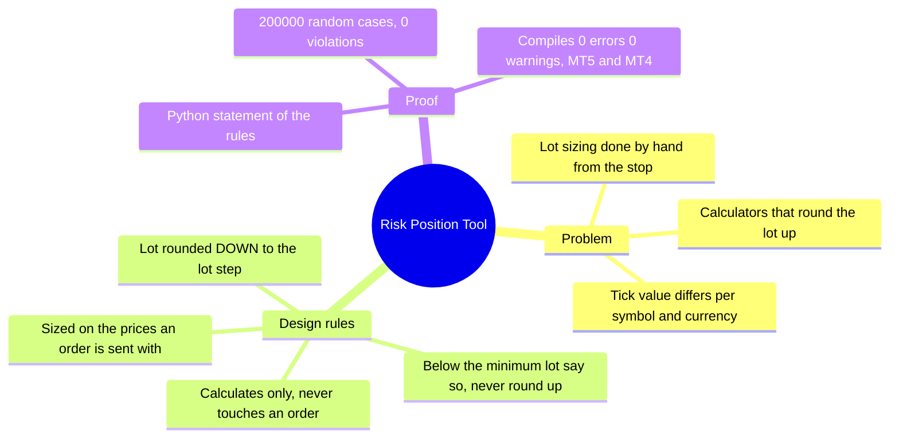

## How it works

### The maths, step by step

Let `E`, `S`, `T` be the entry, stop and target prices read from the lines, `tick` the symbol's tick size, `step`, `vmin`,
`vmax` its lot step, minimum and maximum lot, and `R` the risk setting.

1. **Prices an order is sent with.** Each price is rounded to the tick: `P = round(p / tick) x tick`. The size is measured
   on these, so the stop the broker would receive is the stop that was sized.
2. **Direction.** A stop below the entry is a buy, a stop above it is a sell.
3. **Distances.** `stop_pts = |E - S| / point`, `target_pts = |T - E| / point`, `reward:risk = target_pts / stop_pts`.
4. **Risk money.** Fixed money: `R`. Percent of balance: `balance x R / 100`. Percent of equity: `equity x R / 100`.
5. **Loss of one lot from entry to stop.**
   - MT5: the larger of `|E - S| / tick x tick_value_loss` and the terminal's own `OrderCalcProfit` for one lot.
   - MT4 (no `OrderCalcProfit`): `|E - S| / tick x tick_value`. Where MT4 reports a tick value of 0 (some gold and crypto
     symbols in the tester), it uses `tick size x contract size` in the profit currency, converted to the account currency.
6. **Lot.** `raw = risk money / loss per lot`, then `lot = floor(raw / step + 1e-9) x step`, capped at `vmax`. If
   `lot < vmin` the panel shows no lot and the note `min lot <vmin> risks <money>`.
7. **At the stop** `= lot x loss per lot` (and as a percent of the balance). **At the target:** the profit of `lot` from
   `E` to `T`. **Margin:** the terminal's margin for `lot` at `E`. If the margin is above the free margin, the note says
   `not enough free margin`.

A worked example, from the first screenshot: a USD 10,000 account, risk 1% of balance (USD 100), gold buy with a stop of
2,532 points. Loss per lot is USD 2,532, so `raw = 100 / 2532 = 0.0395` lots, and the lot is `floor(0.0395 / 0.01) x 0.01 =
0.03`, which loses USD 75.96 (0.76% of the balance) at the stop.

When the lines are placed with BUY or SELL, the stop is `stop distance x ATR(14)` away (default 1.5; ATR here is the plain
mean of the last 14 true ranges, at least 10 points) and the target is `reward:risk` times that distance (default 2).

### Per-update algorithm

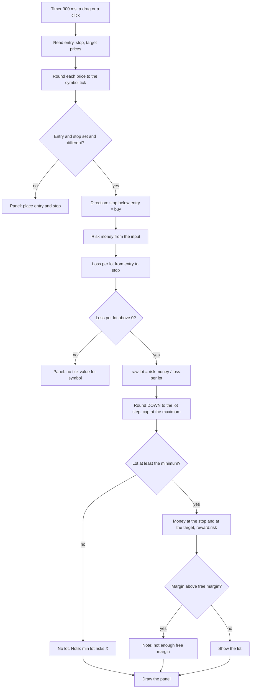

### Entry line states

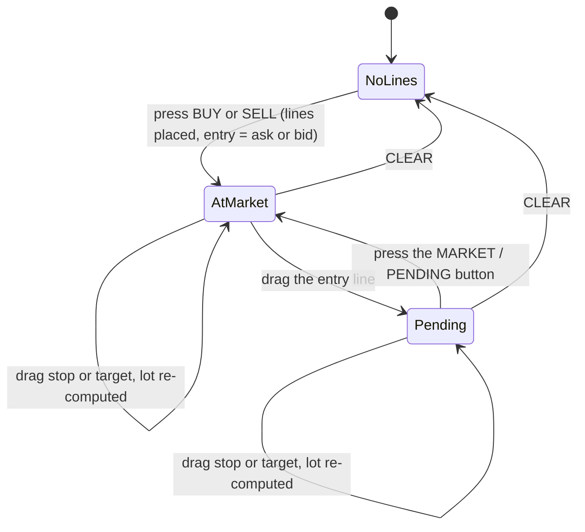

In `Pending`, the panel names the order kind from where the entry line sits: below the ask a buy is a limit, above it a
stop; for a sell the other way round.

### Drag-to-lot flow

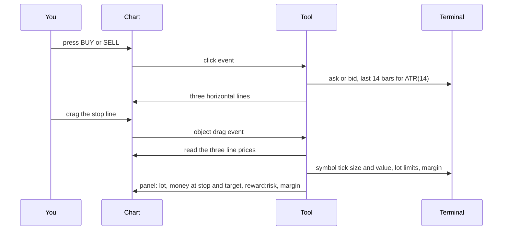

### What the sizing rule produces (measured)

Counts from the property test on 200,000 random setups (six symbol kinds, five lot-step/minimum combinations; source:
[`tests/results/check-sizing.txt`](tests/results/check-sizing.txt)). A random risk smaller than the minimum lot's risk gives
no lot, by design.

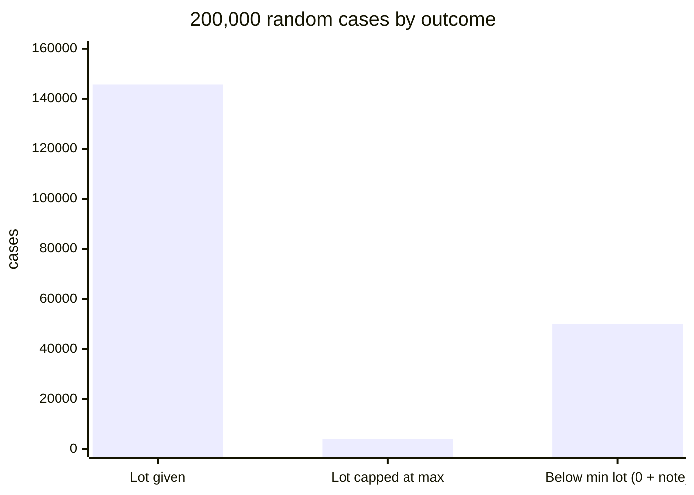

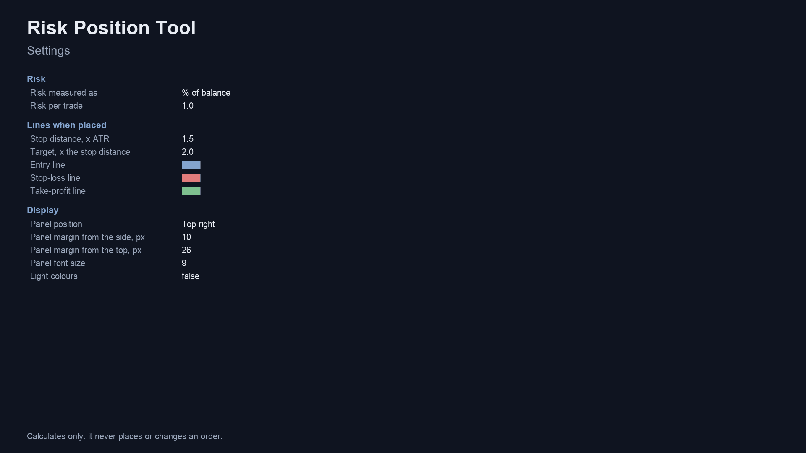

## How it was tested

Only what was actually run is listed here.

| Check | Result |
|---|---|
| Property test of the sizing rules, 200,000 random cases ([`tests/check_sizing.py`](tests/check_sizing.py), fixed seed) | PASS, 0 violations |
| Largest shortfall of the money at the stop below the risk, in lot steps | 0.999998 (the rule is: under 1 step) |
| MT5 indicator compiled with MetaEditor (clean scratch folder, only this repository's files) | 0 errors, 0 warnings |
| MT4 indicator compiled with MetaEditor 4 (clean scratch folder) | 0 errors, 0 warnings |
| MT5 Market build | passed the MQL5 Market's automated product validation before publication (the Market's own check) |

What the property test asserts for every case: the money lost at the stop is never above the risk; it is within one lot
step of the risk when a lot can be given; the lot is a whole number of steps and between the minimum and the maximum; a
risk too small for the minimum lot gives 0 plus a note.

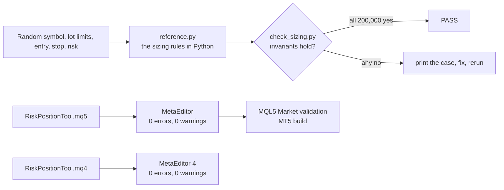

**Not covered:** the Python statement re-states the rules; it is not a bar-by-bar comparison with a terminal, and the
tick-value inputs of the random symbols are synthetic. The MT4 edition has not been through Market validation (it is not
published yet). Brokers whose tick value or margin the terminal reports in unusual ways may differ from these results.

## Architecture

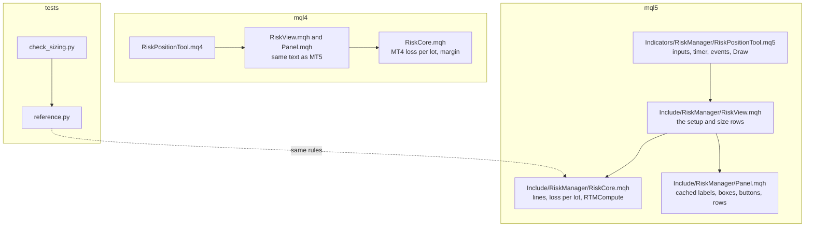

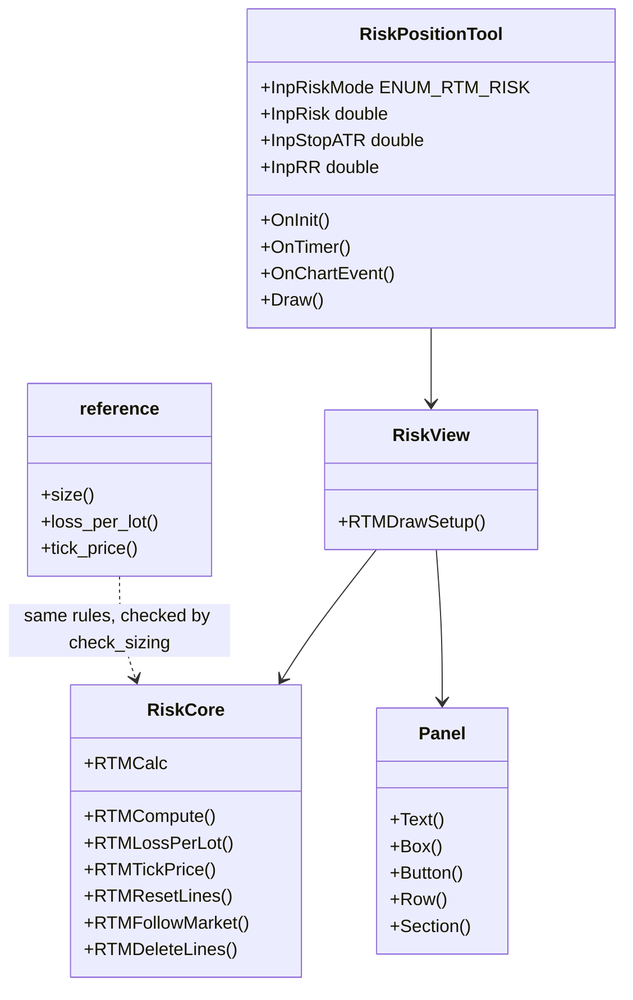

## Inputs, install and compile

| Input | Default | Meaning |
|---|---|---|
| Risk measured as | % of balance | or % of equity, or fixed money |
| Risk per trade (% or money) | 1.0 | the amount of risk to size for |
| Stop distance, x ATR(14) | 1.5 | where the stop line is placed by BUY / SELL |
| Target, x the stop distance | 2.0 | where the target line is placed |
| Entry / Stop-loss / Take-profit line colours | blue / red / green | line colours |
| Panel position, margins, font size | top right, 10 / 26 px, 9 | placement of the panel |
| Light colours (for white charts) | false | switches the panel theme |

Panel buttons: **BUY** and **SELL** place the lines, **MARKET / PENDING** switches the entry between following the price
and a fixed price, **CLEAR** removes the lines. The lines stay on the chart over a timeframe change.

**Install from source.** Copy the `mql5` folder content into `<terminal data folder>/MQL5/` (MT5) or the `mql4` folder
content into `<data folder>/MQL4/` (MT4), keeping the `Include/RiskManager` and `Indicators/RiskManager` folders. Open
`RiskPositionTool.mq5` or `.mq4` in MetaEditor and press Compile (F7). Both compile with 0 errors and 0 warnings (checked
on a Windows machine with MetaEditor, in a scratch folder holding only these files; the compiled files are not in the
repository).

## Run the Python reference and the test

```bash
python3 tests/check_sizing.py            # 200,000 random cases, fixed seed; prints PASS or FAIL
python3 tests/check_sizing.py 1000000    # more cases
```

```python
import sys; sys.path.insert(0, "tests")
from reference import Symbol, size
eurusd = Symbol(tick_size=0.00001, tick_value=1.0, vol_step=0.01, vol_min=0.01, vol_max=100)
lots, money_at_stop, note = size(eurusd, entry=1.1000, sl=1.0950, risk_money=100)   # (0.2, 99.99999999999787, ''), i.e. 0.2 lots, about 100
```

The test needs only the Python standard library.

## Honest limits

- **A size is not a strategy.** The tool does not pick entries, stops or targets, and says nothing about whether a trade is
  a good one.
- **The risk is not exact.** The lot is rounded down, so the money at the stop is at or below what you asked. A stop can
  fill further away than its line (slippage, gaps), spread and commission are not in the number, and a broker may change a
  symbol's tick value or margin.
- **Minimum lot.** If the minimum lot risks more than you asked, no lot is shown. The tool does not round up.
- **Prices are rounded to the tick** before sizing. A line dragged between two ticks is sized as the tick it would be sent at.
- **One symbol per chart.** The lines belong to the chart's symbol.
- **Scope of the tests.** The property test uses synthetic symbol data and checks rules, not a terminal. See
  [How it was tested](#how-it-was-tested).
- No profit or accuracy claim is made.

## Free vs Pro

| | Free: Risk Position Tool | Paid: Risk Trade Manager |
|---|---|---|
| Platforms | MT5 [201865](https://www.mql5.com/en/market/product/201865), MT4 coming soon | MT5 [201867](https://www.mql5.com/en/market/product/201867), MT4 coming soon |
| Price | free | paid (see the Market page) |
| What you get | the three lines, lot for your risk, money at the stop and target, reward:risk, margin | sends orders from the same lines and manages them with partial close, break-even and trailing stop, as described on its Market listing |
| Source | this repository | not published |

No need to buy the paid product to use the free one: the free tool is complete on its own.
Website: [allanninal.dev/mql5](https://www.allanninal.dev/mql5/#utilities) ([MT4](https://www.allanninal.dev/mql5/#mt4)).

## Licence

Everything in this repository is © 2026 Allan Niñal under the
[PolyForm Noncommercial License 1.0.0](LICENSES/PolyForm-Noncommercial-1.0.0.md): source-available, free for personal and
other noncommercial use, not for commercial use. Each source file has an `SPDX-License-Identifier` line. Text:
[`LICENSE`](LICENSE). The licence applies to this source, not to anything you build or trade with the tool. Trading
involves risk; the software is provided as is.

---

**Website:** [allanninal.dev/mql5](https://www.allanninal.dev/mql5/#utilities) · [MT4](https://www.allanninal.dev/mql5/#mt4) · [allanninal.dev](https://www.allanninal.dev)
· Questions: message me on [LinkedIn](https://www.linkedin.com/in/allanninal/).
